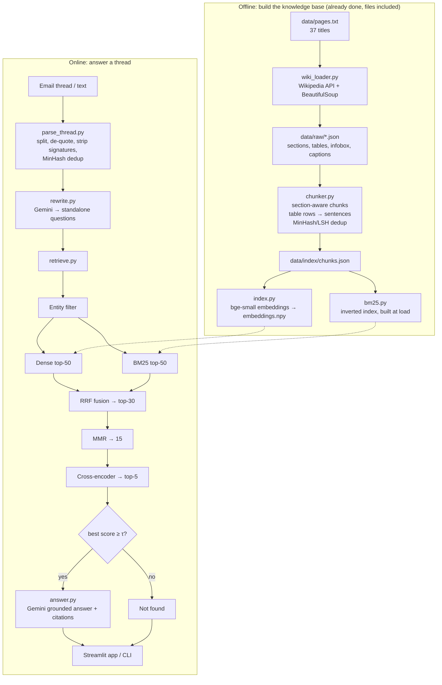

# RAG_thread: Email Thread Question Answering over Wikipedia

RAG_thread reads an email thread (a mail with chained, quoted replies) or plain text, works out what is actually being asked, retrieves supporting **text and table rows** from Wikipedia pages on the **Indian states and union territories**, and returns a short **grounded answer with citations**. If the pages do not contain the answer, it says **"not found"** instead of guessing.

```
Email thread ──► clean & dedup ──► Gemini rewrite ──► hybrid retrieval ──► re-rank ──► grounded answer + citations
                 (quotes, signatures,  (standalone        (dense + BM25,        (cross-     (or "not found")
                  MinHash dedup)        questions)          RRF, MMR)             encoder)
```

---

## Quick start: download and run in 6 steps

You only need **Python**, a **free Gemini API key** and an internet connection. The Wikipedia data and search index are already included in this repository, so nothing has to be built.

**Step 1: Install Python (3.11 or newer).**
Download it from https://www.python.org/downloads/ (on Windows, tick **"Add Python to PATH"** during installation). Check it:
```bash
python3 --version        # macOS / Linux
python --version         # Windows
```
You should see `Python 3.11` or higher.

**Step 2: Download the code.** Choose one:
- **With Git:**
  ```bash
  git clone https://github.com/<your-username>/RAG_thread.git
  cd RAG_thread
  ```
- **Without Git:** on the GitHub page click **Code → Download ZIP**, unzip it, and open a terminal inside the unzipped `RAG_thread` folder (the folder that contains `app.py`).

**Step 3: Create a virtual environment and install the libraries** (takes 2-5 minutes; PyTorch is large).

macOS / Linux:
```bash
python3 -m venv .venv
source .venv/bin/activate
pip install -r requirements.txt
```
Windows (PowerShell):
```powershell
python -m venv .venv
.\.venv\Scripts\Activate.ps1
pip install -r requirements.txt
```
If PowerShell blocks the activate script, run `Set-ExecutionPolicy -Scope CurrentUser RemoteSigned` once and try again.
After activation, your prompt starts with `(.venv)`.

**Step 4: Add a Gemini API key.**
1. Create a free key at https://aistudio.google.com/apikey (sign in with a Google account → **Create API key**).
2. Copy the example settings file:
   ```bash
   cp .env.example .env        # macOS / Linux
   copy .env.example .env      # Windows
   ```
3. Open `.env` in any text editor and paste your key after `GEMINI_API_KEY=`:
   ```
   GEMINI_API_KEY=AIza...your key...
   GEMINI_MODEL=gemini-3.5-flash-lite
   GEMINI_FALLBACK_MODEL=gemini-3.6-flash
   ```

**Step 5: Check the installation** (no API key or internet needed):
```bash
python -m tests.test_parse_minhash
```
Expected last line: `all tests passed`.

**Step 6: Start the app.**
```bash
streamlit run app.py
```
Your browser opens http://localhost:8501 (open it manually if it does not). The first start takes about a minute: two small models (~220 MB) download once, then load. In the sidebar pick **Sample thread → thread1.txt** and click **Run**. You should see the cleaned thread, two standalone questions, and cited answers (Kerala had the higher literacy rate; the capitals are Thiruvananthapuram and Chennai).

To stop the app press `Ctrl + C` in the terminal. Next time, only run `source .venv/bin/activate` (or `.\.venv\Scripts\Activate.ps1`) and `streamlit run app.py`.

No browser? Use the command line instead:
```bash
python run_cli.py data/sample_threads/thread1.txt
```

If anything fails, see [Troubleshooting](#troubleshooting).

---

## Contents
1. [Features](#features)
2. [Architecture](#architecture)
3. [Prerequisites](#prerequisites)
4. [Setup](#setup)
5. [Run the app (Streamlit)](#run-the-app-streamlit)
6. [Run from the command line](#run-from-the-command-line)
7. [Evaluation](#evaluation)
8. [Rebuilding the data (optional)](#rebuilding-the-data-optional)
9. [Project structure](#project-structure)
10. [Configuration](#configuration)
11. [Troubleshooting](#troubleshooting)
12. [Limitations and future work](#limitations-and-future-work)

---

## Features
- **Thread parsing:** splits a pasted thread into messages (`On … wrote:`, `-----Original Message-----`, `From:`), removes `>` quote marks, headers, greetings, signatures and disclaimers, orders messages oldest-first, and removes repeated quoted paragraphs with **MinHash + LSH** (implemented from scratch).
- **Question rewriting (Gemini):** resolves references ("that state", "the larger one", "UP", "Pondy") using the whole thread and splits multi-question mails into standalone questions.
- **Knowledge base:** 71 Wikipedia pages (28 states, 8 UTs, the summary page and the district-list pages), parsed into **section text, table rows (as sentences), infobox fields and image captions**: 7,470 chunks.
- **Hybrid retrieval (from scratch):** dense cosine search over a NumPy matrix (bge-small-en-v1.5) + hand-written **BM25** → **Reciprocal Rank Fusion** → **MMR** diversity → **cross-encoder** re-ranking.
- **Entity filter:** restricts the search to the pages of the states named in the question (with aliases such as UP, TN, Orissa).
- **Grounded answers:** Gemini answers only from the top-5 passages and cites them as `[n]`; every source links to its Wikipedia page and section.
- **Two "not found" gates:** a re-rank score threshold (no LLM call) and the LLM's own `NOT_FOUND` reply.
- **Robust to API problems:** an automatic fallback model, and if Gemini is unavailable the retrieved evidence is still shown.
- **Evaluation:** recall@5, MRR@10, nDCG@5 for every retrieval stage, not-found accuracy with a threshold sweep, and a faithfulness check.

---

## Architecture



---

## Prerequisites
- **Python 3.11 or newer** (developed and tested on Python 3.14, macOS).
- **Git**.
- **A Google Gemini API key** (free): create one at https://aistudio.google.com/apikey
- **Internet access** for the first run, which downloads two small models from Hugging Face:
  `BAAI/bge-small-en-v1.5` (~130 MB) and `cross-encoder/ms-marco-MiniLM-L-6-v2` (~90 MB).
- About **1.5 GB** of free disk space (mostly PyTorch).

The Wikipedia data, chunks and embeddings are **already included** in the repository, so you do not need to download Wikipedia or rebuild the index.

---

## Setup

### macOS / Linux
```bash
git clone https://github.com/<your-username>/RAG_thread.git
cd RAG_thread
python3 -m venv .venv
source .venv/bin/activate
pip install -r requirements.txt
cp .env.example .env
```

### Windows (PowerShell)
```powershell
git clone https://github.com/<your-username>/RAG_thread.git
cd RAG_thread
python -m venv .venv
.\.venv\Scripts\Activate.ps1
pip install -r requirements.txt
copy .env.example .env
```

### Add your API key
Open `.env` and set your key:
```
GEMINI_API_KEY=your_key_here
GEMINI_MODEL=gemini-3.5-flash-lite
GEMINI_FALLBACK_MODEL=gemini-3.6-flash
```
Any Gemini Flash model available to your key works. To list the models your key can use:
```bash
python -c "import config;from google import genai;c=genai.Client(api_key=config.GEMINI_API_KEY);[print(m.name) for m in c.models.list() if 'flash' in m.name]"
```

### Check the installation (no API key needed)
```bash
python -m tests.test_parse_minhash
```
Expected last line: `all tests passed`.

---

## Run the app (Streamlit)
```bash
streamlit run app.py
```
Open http://localhost:8501.

1. In the sidebar, choose **Sample thread**, **Paste text** or **Upload .txt**.
2. Click **Run**.
3. The page shows the cleaned thread and parser statistics, the standalone questions, and for each question the answer, its cited Wikipedia sources and (optionally) the ranking at every retrieval stage.

The first load takes about 40 seconds (models and index load once per server). Later questions take a few seconds, mostly the Gemini calls.

Sample threads are in `data/sample_threads/`:
- `thread1.txt`: a messy multi-reply thread with quotes, an Outlook copy, signatures and "that state"
- `thread2.txt`: two questions using the short forms "UP" and "TN"
- `thread3.txt`: an off-topic question that should come back as not found

---

## Run from the command line
```bash
python run_cli.py data/sample_threads/thread1.txt
python run_cli.py --text "Which state has Shillong as its capital?"
python run_cli.py data/sample_threads/thread1.txt --debug     # also prints every retrieval stage
```

Individual stages can also be run on their own:
```bash
python -m src.parse_thread data/sample_threads/thread1.txt   # thread cleaning only
python -m src.retrieve                                       # retrieval only, no Gemini needed
```

---

## Evaluation
`data/test_threads.json` contains 25 test cases: easy, aliases, paraphrase, multi-turn references, follow-up-only mails, noisy forwarded threads, two questions in one mail, numeric comparisons, table lookups, multi-hop questions and 4 unanswerable questions. Each case lists the gold pages and the keywords a relevant chunk must contain.

```bash
python -m src.evaluate            # runs all 25 cases (about 5 minutes, ~50 Gemini calls)
python -m src.evaluate --reuse    # recomputes the metrics from saved results, no API calls
```
Results are written to `data/eval/` (`run_results.json`, `metrics.json`, `per_case.csv`).

### Results (one run, gemini-3.5-flash-lite)

**Retrieval by stage** (25 gold items):

| Stage | Recall@5 | MRR@10 | nDCG@5 |
|---|---|---|---|
| Dense (bge-small) | 0.880 | 0.667 | 0.547 |
| BM25 | 0.760 | 0.693 | 0.477 |
| RRF (dense + BM25) | 0.880 | 0.743 | 0.553 |
| MMR | 0.880 | 0.673 | 0.529 |
| **Cross-encoder (final)** | **0.920** | **0.775** | **0.640** |

**End to end:**
- Answer / not-found decision accuracy: **0.96** (24/25). All 4 unanswerable cases were rejected, including a question about Kerala's GDP in 2040 that the score threshold alone could not catch.
- Answer accuracy (expected keywords present): **1.00**
- Answers with at least one citation: **1.00**, invalid citations: **0**
- Numbers in answers found in the cited passages: **29/29**

The one miss is a paraphrase query ("Which Indian state is known as God's Own Country?") whose answer chunk fell outside the candidate pool before re-ranking. Gemini output can vary slightly between runs, so metrics may differ by a few hundredths.

---

## Rebuilding the data (optional)
Only needed if you want fresh Wikipedia content or change the page list.
```bash
python -m src.wiki_loader --refresh   # downloads 73 pages (~3 min, polite rate limiting)
python -m src.chunker                 # builds data/index/chunks.json
python -m src.index                   # builds data/index/embeddings.npy (~1 min on CPU)
```
To add pages, add their Wikipedia titles to `data/pages.txt` (one per line). The district-list page for each state is added automatically.

---

## Project structure
```
RAG_thread/
├── app.py                  Streamlit interface
├── run_cli.py              command-line interface
├── config.py               paths, model names, parameters (reads .env)
├── requirements.txt
├── .env.example
├── prompts/
│   ├── rewrite.txt         thread → standalone questions
│   └── answer.txt          grounded answer with citations
├── data/
│   ├── pages.txt           Wikipedia titles to load
│   ├── aliases.json        short forms for the entity filter (UP, TN, Orissa, ...)
│   ├── raw/                parsed Wikipedia pages (JSON)
│   ├── index/              chunks.json, embeddings.npy, index_meta.json
│   ├── sample_threads/     example email threads
│   ├── test_threads.json   evaluation cases with gold labels
│   └── eval/               evaluation outputs
├── src/
│   ├── parse_thread.py     thread splitting, cleaning, dedup
│   ├── minhash.py          shingles, MinHash, LSH banding
│   ├── wiki_loader.py      Wikipedia download and HTML parsing
│   ├── chunker.py          section-aware chunking, table rows → sentences
│   ├── index.py            embeddings and dense cosine search
│   ├── bm25.py             BM25 with an inverted index
│   ├── retrieve.py         entity filter, RRF, MMR, re-ranking, not-found gate
│   ├── llm.py              Gemini client with model fallback
│   ├── rewrite.py          question rewriting
│   ├── answer.py           grounded answer generation
│   ├── pipeline.py         end-to-end pipeline
│   └── evaluate.py         retrieval and answer metrics
├── tests/
│   └── test_parse_minhash.py
├── docs/                   report and architecture diagram
└── screenshots/            input, data structures, processing steps, outputs
```

---

## Configuration
All settings are in `config.py`; the Gemini settings come from `.env`.

| Setting | Default | Meaning |
|---|---|---|
| `GEMINI_MODEL` | from `.env` | main LLM for rewriting and answering |
| `GEMINI_FALLBACK_MODEL` | from `.env` | used automatically if the main model fails |
| `EMBED_MODEL` | `BAAI/bge-small-en-v1.5` | embedding model for chunks and questions |
| `RERANK_MODEL` | `cross-encoder/ms-marco-MiniLM-L-6-v2` | re-ranker |
| `CHUNK_WORDS` / `CHUNK_OVERLAP` | 200 / 30 | text chunk size and overlap (words) |
| `NUM_HASHES` / `LSH_BANDS` / `DUP_THRESHOLD` | 64 / 8 / 0.8 | MinHash deduplication |
| `BM25_K1` / `BM25_B` | 1.5 / 0.75 | BM25 parameters |
| `DENSE_TOP_K` / `BM25_TOP_K` | 50 / 50 | candidates from each retriever |
| `RRF_K` / `RRF_TOP` | 60 / 30 | fusion constant and fused pool size |
| `MMR_LAMBDA` / `MMR_TOP` | 0.7 / 15 | relevance vs diversity, candidates to re-rank |
| `FINAL_TOP` | 5 | passages given to the LLM |
| `NOT_FOUND_THRESHOLD` | 0.2 | minimum re-rank probability to attempt an answer |

---

## Troubleshooting
| Problem | Fix |
|---|---|
| `GEMINI_API_KEY missing` | Copy `.env.example` to `.env` and add your key. |
| `404 NOT_FOUND ... model` | The model name is not available to your key. List your models (see Setup) and change `GEMINI_MODEL` in `.env`. |
| `503 UNAVAILABLE` / `429 RESOURCE_EXHAUSTED` | Gemini is busy or the free-tier rate limit was hit. The fallback model is tried automatically; otherwise wait a minute and retry. Use `python -m src.evaluate --reuse` to avoid repeat API calls. |
| `NOTE: Redirects are currently not supported in MacOs` | A harmless PyTorch warning on macOS; ignore it. |
| First run is slow | The two Hugging Face models are downloading (one time only). |
| Port 8501 in use | `streamlit run app.py --server.port 8502` |
| `embeddings.npy does not match chunks` | Rebuild with `python -m src.index` after re-running the chunker. |

---

## Limitations and future work
- **Paraphrases with no word overlap** can miss the candidate pool when the dense model also ranks them low. Possible fixes: query expansion or HyDE, a larger candidate pool tuned on a separate dev set, or a stronger embedding model.
- **Numeric comparisons** rely on the LLM reading values from retrieved rows; a pandas-based numeric lookup over the tables would make them exact.
- **Evaluation labels** are page + keyword based (an approximation of manual relevance judgements), and the test set is small (25 threads).
- **Faithfulness** is checked automatically (valid citations, numbers present in cited passages); an LLM-as-judge or human review would be stronger.
- Images are represented only by their captions (no vision model).
- The data is a snapshot of Wikipedia taken in October 2026.